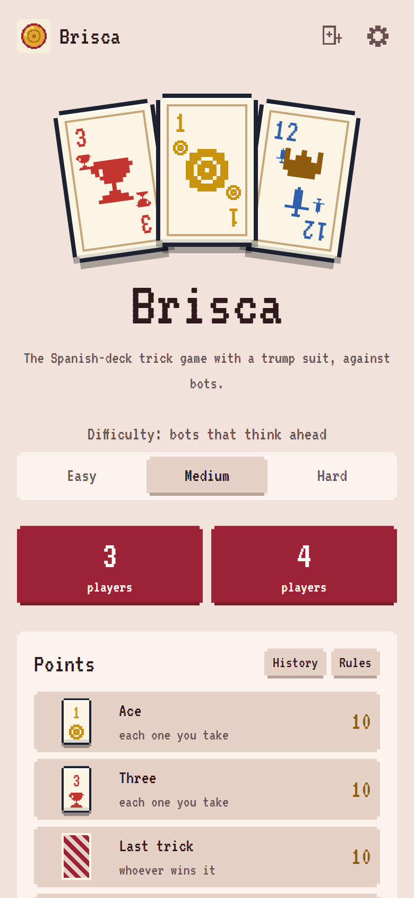
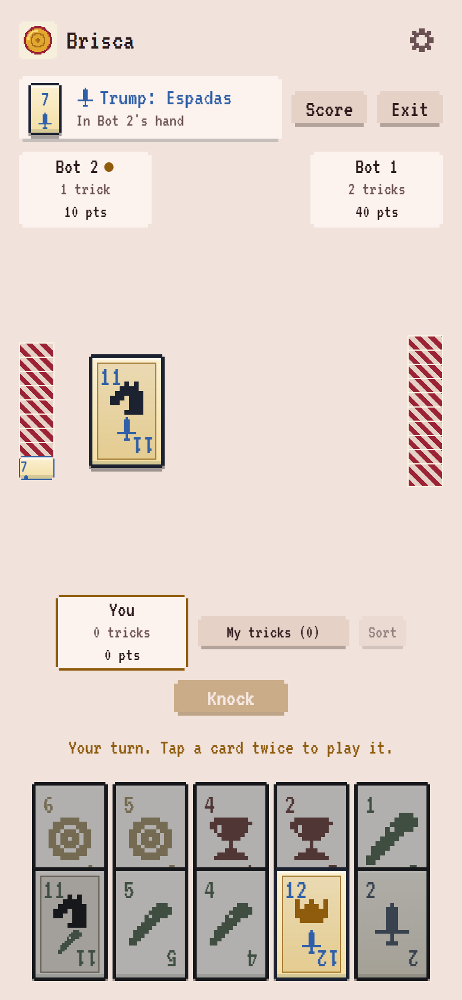

# Brisca

Play Brisca, the Spanish-deck trick game with a trump suit, on your phone or computer. Against bots
that count cards, for 3 or 4 players, each one on their own.

No account and no backend. Everything runs on your device, and your match is saved after every move.

- **Live:** https://tletelieru.github.io/brisca/

<p align="center">
  
  &nbsp;
  
</p>

## How to play

The whole deck is dealt in packets, starting with the player after the dealer: with 3 players (the 2
of bastos is removed) a packet of 6 and then one of 7, 13 cards each; with 4 players two packets of 5,
10 cards each. The last card dealt goes to the dealer face up: its suit is trump for the whole match,
and the dealer keeps it as a normal card.

- Whoever leads plays any card. Then you must follow suit, and while nobody has trumped you must beat
  the best card on the table if you can
- With none of the suit led you must trump, and over a trump you must play a higher one if you can.
  If you cannot, or you have neither the suit nor trumps, play any card
- A trump beats any other suit. Otherwise the highest card of the suit led wins
- Order, high to low: Ace, 3, King, Knight, Jack, 7, 6, 5, 4, 2

| Points | |
| --- | --- |
| Each Ace or 3 you take | 10 |
| Last trick | 10 |
| King + Knight of the same suit (canto) | 20 |
| King + Knight of trumps | 40 |

To sing a canto you knock when you play the first of the two; play it without knocking and the canto
is gone. It counts for you even if someone else takes that trick. Most points wins; a tie on points
goes to the monos in each player's tricks (Ace 1, King 4, Knight 3, Jack 2). The full rules are inside
the game.

## What you get

- **Three difficulties:** Easy plays simple rules, Medium simulates the rest of the game before it
  moves, and Hard counts cards and plays the endgame perfectly. No bot ever sees your cards
- **3 or 4 players:** you against 2 or 3 bots, every player on their own
- **Spanish deck in pixel art:** oros, copas, espadas and bastos, numbered 1 to 7 and 10 to 12 like a real
  deck, with a page, a horse and a crown on the figures and trump cards marked in gold
- **Drawing for dealer:** a spotlight hops around the table and stops on whoever deals
- **Cantos:** knock when you play a King or Knight to sing 20 or 40, with a knock sound and a call
  everyone sees
- **Arrange your hand:** drag cards to put them in any order, or tap Sort to group them by suit
- **Rules you cannot break:** cards you are not allowed to play are dimmed, and tapping one tells you why
- **Its own music:** chiptune themes on the Andalusian cadence, with a tenser one for your last cards,
  plus short sound effects. Both can be turned off
- **Illustrated rules:** every rule comes with an example made of real cards
- **Match history:** finished and abandoned matches, with the points and tricks of every player
- **Saved matches:** reload, close the tab or turn off your phone, and the match comes back
- **Live score and My tricks:** check the points so far and the tricks you have taken

### Accessibility and comfort

Settings has larger text sizes, a regular font instead of the pixel one, switches for music and sound
effects and a switch to turn off animations. Hints, like marking the card that is winning the trick,
only appear on Easy. It also comes in English and Spanish, with light and dark mode. Install it as an app and it
works offline.

## How strong are the bots?

Each row is one bot against a table of the other, rotating seats over the same deals. Run it with
`pnpm sim`.

| Bot | Against | Players | Matches | Wins | Ties | Avg points | Even odds | Avg ms/move | Max ms/move |
| --- | --- | --- | --- | --- | --- | --- | --- | --- | --- |
| Easy | Random | 3 | 192 | 45.3% ±7.0 | 0.0% | 42.9 | 33.3% | 0.01 | 0.6 |
| Medium | Easy | 3 | 192 | 38.0% ±6.9 | 0.0% | 44.7 | 33.3% | 0.73 | 7.8 |
| Hard | Medium | 3 | 192 | 34.9% ±6.7 | 1.6% | 41.2 | 33.3% | 7.64 | 66.3 |
| Hard | Easy | 3 | 192 | 44.3% ±7.0 | 0.0% | 47.1 | 33.3% | 9.45 | 75.4 |
| Easy | Random | 4 | 192 | 31.8% ±6.6 | 0.5% | 29.3 | 25.0% | 0.00 | 0.2 |
| Medium | Easy | 4 | 192 | 29.7% ±6.5 | 0.5% | 31.9 | 25.0% | 0.48 | 11.4 |
| Hard | Medium | 4 | 192 | 28.6% ±6.4 | 1.0% | 29.0 | 25.0% | 5.82 | 56.7 |
| Hard | Easy | 4 | 192 | 35.4% ±6.8 | 1.6% | 33.8 | 25.0% | 6.25 | 52.4 |

The mandatory plays leave few real choices and the deal decides a lot, so the margins are small: Hard
beats Medium and Medium beats Easy at both table sizes. Times are from a desktop with no time budget;
in the app each move also stops at 60 ms (Medium) or 120 ms (Hard).

## Run it locally

Requires Node 24 and pnpm 9.

```sh
pnpm install
pnpm dev
```

| Command | What it does |
| --- | --- |
| `pnpm test` | Runs the unit and property tests |
| `pnpm lint` | Runs ESLint |
| `pnpm typecheck` | Runs the type checks |
| `pnpm build` | Builds the app |
| `pnpm sim` | Plays every level against the one below, with 3 and 4 players |
| `pnpm sim --hero hard --field medium --players 3 --matches 400` | Plays one matchup |

## How it works

| Folder | What lives there |
| --- | --- |
| `packages/engine` | Rules, legal moves and scoring, with no UI code |
| `packages/bots` | Easy, Medium and Hard |
| `apps/client` | The game, built with React, Tailwind and Vite |
| `apps/sim` | Command line tool for bot matches |

The engine is pure and serializable, so saved matches, the bots and a future online server all share
it. Bots only receive what their seat can see: their own hand, how many cards everyone holds, the cards
played, the cantos and the trump. Thousands of random matches check that no card is ever lost or
duplicated, that the points always add up (80 in aces and threes, 10 for the last trick, plus the
cantos) and that illegal moves are rejected.

The thinking bots deal out the cards they cannot see in many possible ways, play each option to the end
of the game and pick the one that does best for them. Hard also reads the tricks to learn who is out of
a suit or could not beat the table, and solves the last few tricks exactly. Every move has a time
budget, so even with 13 cards in hand a bot answers in a fraction of a second, and they run in a Web
Worker, so the table never freezes.

All cards, icons and music are original. See [the development plan](docs/PLAN.md), in Spanish, for what comes
next.

## License

Copyright (c) 2026 tletelieru. All rights reserved. See [LICENSE](LICENSE).

---

Part of the games by [tletelieru](https://tletelieru.github.io/tletelieru/), alongside
[7 de Trébol](https://github.com/tletelieru/7-de-trebol).
